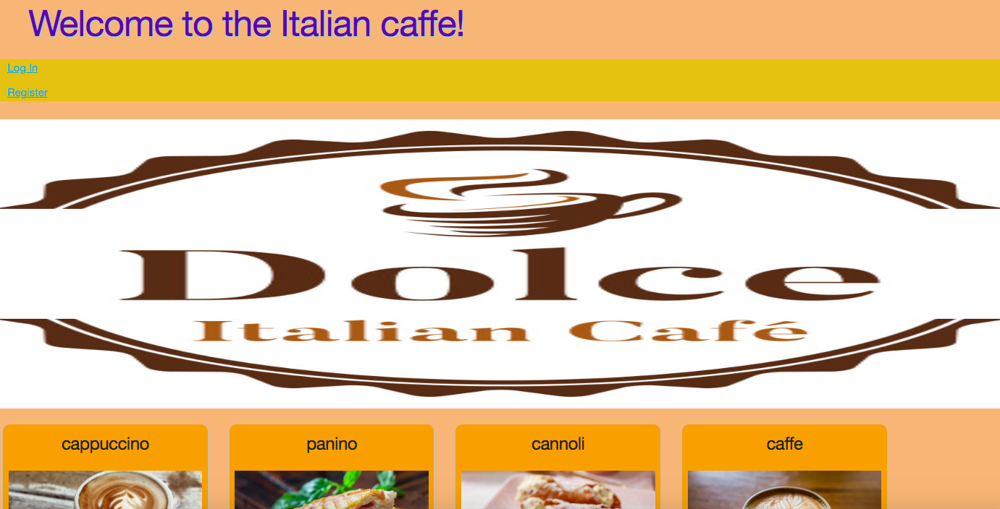

# caffegithubmichelecreanza.github.io

Michele coffe app

coffe link https://github.com/michelecreanza/caffegithubmichelecreanza.github.io/tree/master/coffe_app

Technologies Used:

Javascript
Jquery
Node.js
Mongoose
Express and EJS
RESTful routes and full CRUD.
sign up/log in functionality, with encrypted passwords & an authorization flow
Use EJS Partials
portfolio-quality styling
Google Maps
Paypal sandbox

A Coffe shop represents a shop All Product can be accessed via a particular id with Buy delete Update options

brew trust mongodb/brew
brew install mongodb-community@8.0
brew services start mongodb-community@8.0
mongosh --eval "db.runCommand({ ping: 1 })"

brew tap mongodb/brew
brew install mongodb-community@8.0
brew services start mongodb-community@8.0
mongosh --eval "db.runCommand({ ping: 1 })"

mkdir -p "$HOME/mongodb-fresh"
mongod --dbpath "$HOME/mongodb-fresh" --bind_ip 127.0.0.1 --port 27017

http://localhost:27017/

npm start

http://localhost:3000.
